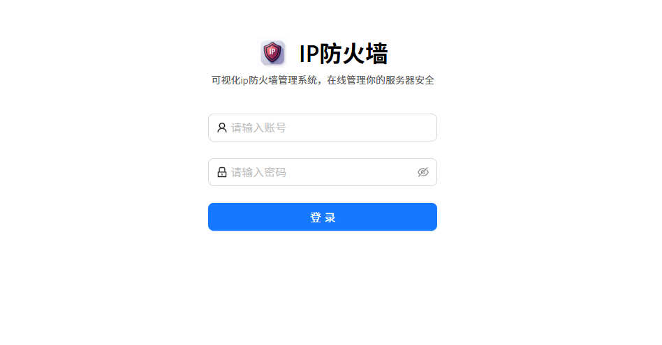
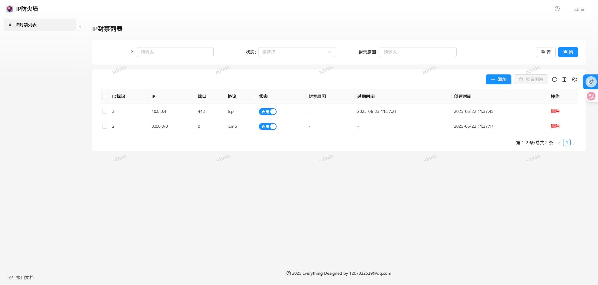

# hello_firewall

## 介绍

可视化ip防火墙管理系统，使用go语言编写相关接口，底层防火墙驱动是iptables，提供API调用

## 安装

## 安装方式一：命令行启动

- 安装依赖包

```
go mod tidy
```

- 直接启动运行
  使用go运行

```
go run main.go serve
```

- 使用gin运行（热重载）

```
gin serve run main.go
```

## 安装方式二：docker

- 新建docker-compose.yml文件

```yaml
version: "3"
services:
  hello_firewall:
    image: ghcr.io/luler/hello_firewall:latest
    privileged: true
    network_mode: host
    restart: always
    environment:
      - TZ=Asia/Shanghai  #时区
      - PORT=3000          #服务端口
      - ADMIN_NAME=admin      #管理员账号
      - ADMIN_PASSWORD=admin  #管理员登录密码
      - JWT_EXPIRE=7200 #访问token过期时间，单位秒
      - JWT_SECRET=Hw_KtnqHJ   #页面访问token加密秘钥，自定义一个复杂的
      - IPTABLES_TARGET_CHAINS=INPUT,DOCKER-USER #iptables目标链
      - DATABASE_DEFAULT_DRIVER=sqlite #数据库驱动
      - DATABASE_DEFAULT_NAME=runtime/hello_firewall.sqlite #数据库文件路径
    volumes:
      - ./runtime:/app/runtime

```

- 启动容器

```bash
docker-compose up -d
```

## 使用

- 访问地址：http://localhost:3000
  默认账号：admin，密码：admin

## 注意事项与规则生命周期

1. **服务停止 / 容器 Down 后的规则生效机制**
   - 容器采用 `network_mode: host` 与 `privileged: true` 模式，直接操作宿主机 Linux 内核 Netfilter。
   - **当容器停止或执行 `docker-compose down` 后，已下发的 iptables 规则依然会留在宿主机内核中持续生效，不会被自动清空。**
2. **临时封禁到期解封说明**
   - 如果规则配置了“过期时间”，在服务停止期间，负责检测并解封的 Cron 定时任务无法运行；因此设置了过期时间的规则在此期间会保持封禁状态，直到重新启动服务后自动触发解封。
3. **宿主机重启后的规则恢复**
   - Linux 内核内存中的 iptables 规则在宿主机重启后会被系统重置，SQLite 数据库中的规则配置不会丢失。
4. **手动彻底清理规则的方法**
   - 如果停止使用本服务并希望彻底清空宿主机上的相关规则，请在宿主机执行以下命令：
     ```bash
     # 1. 从目标链中解绑 HELLO-FIREWALL
     iptables -D INPUT -j HELLO-FIREWALL -m comment --comment "managed-by-hello-firewall" 2>/dev/null || true
     iptables -D DOCKER-USER -j HELLO-FIREWALL -m comment --comment "managed-by-hello-firewall" 2>/dev/null || true

     # 2. 清空并删除自定义规则链
     iptables -F HELLO-FIREWALL
     iptables -X HELLO-FIREWALL
     ```

- 页面示例截图
  
  
